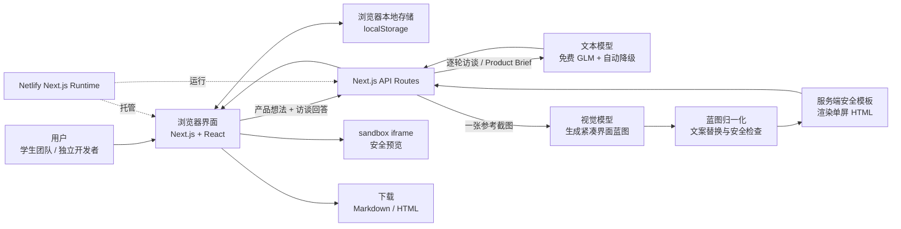

# ProductZero

ProductZero 是面向学生创业团队、独立开发者和早期产品团队的 AI 产品发现与原型生成工作台。

它不把 AI 当成“代写文档机”，而是把一句模糊的产品想法整理成一套可以讨论、验证和交付的结果：

- 根据上一回答逐轮生成的 8 轮证据访谈
- 带关键判断与依据、决策记录的 Product Brief
- 带来源轮次与原文摘录的假设证据链
- 基于还没确认的判断和目前还不知道什么生成的下一轮验证问题
- 基于一张参考截图生成的单屏 HTML 原型
- 原型设计分析、主动修改说明和设计理由

## 一分钟了解

| 项目 | 说明 |
| --- | --- |
| 面向用户 | 学生创业团队、独立开发者、早期产品团队 |
| 核心问题 | 想法停留在口号层面；事实和猜测混在一起；访谈、文档与原型分散在不同工具里 |
| 产品承诺 | 把模糊想法快速转化为可讨论、可验证、可交付的第一版产品方案 |
| 当前 MVP | 单用户、单项目、一次完整产品推演、一张参考图、一个单屏原型 |
| 演示视频 | 可选，暂不录制；新版界面截图将在定稿后重新生成 |

## 线上体验

- 产品首页：https://productzero-demo.netlify.app
- 原型模块：https://productzero-demo.netlify.app/prototype
- 当前状态：线上版本可以访问；Netlify 免费额度周期内暂停新的生产部署。暂不购买、升级或迁移 Netlify。

## 产品背景

### 用户遇到的问题

第一次做产品的人通常不缺“点子”，真正困难的是下面几件事：

1. **想法太模糊。** “做一个 AI 工具”听起来合理，但谁最需要它、什么时候用、现在怎么凑合解决都不清楚。
2. **事实和假设混在一起。** 用户访谈还没开始时，很多判断已经被当成了结论。
3. **文档和原型割裂。** 访谈记录、PRD、设计参考和 HTML 原型通常分散在多个工具里，需要反复整理。
4. **AI 输出很多，但缺少判断。** 直接让 AI 写 PRD（准备开发时使用的详细需求文档）很容易得到一份看起来完整、实际上没有验证优先级的内容。

### ProductZero 的处理方式

ProductZero 先帮助用户暴露风险，再生成文档和原型：

- **先追问：** 用 8 轮证据访谈了解真实场景、现有替代方案、发生频率、实际代价和最危险假设。
- **再确认：** 逐条保留用户原话，生成更清楚的整理内容，由用户确认或修改。
- **再整理：** 把确认后的回答整理成要解决的问题、4 条关键假设、2 条决策记录和 3 个下一步行动。
- **最后做原型：** 上传一张参考截图，生成一屏可预览的 HTML，并解释保留了哪些结构、主动修改了什么。

## 核心工作流

### 1. 写下产品想法

用户用一段自然语言描述一个用户、一个问题或一个希望被解决的场景。内容暂存在浏览器 `localStorage` 中，不需要登录。

### 2. 完成 8 轮证据访谈

每次只显示一个问题。AI 会读取前面所有回答，再决定下一问；接口会校验上一答引用和单问格式，模型返回多问时会自动重试或换成单问备用问题：

1. 最近一次真实遇到这个问题的人是谁，处在什么场景？
2. 那次经历里最先开始做的具体动作是什么？
3. 当时具体卡在哪个步骤或问题上？
4. 试过哪些替代办法，或者找过谁帮忙？
5. 那次经历最终发生了什么结果？
6. 从开始处理到结束，实际花了多少时间或代价？
7. 这件事过去一个月大约发生过几次？
8. 哪个判断如果错了会让方向失效？

所有后续追问都必须承接上一轮的具体对象、动作、原话或数字。若 AI 暂时不可用，界面会切换到同样承接上一答的单问备用问题，保证流程仍可继续。

> 8 轮访谈仍然产出“首版假设稿”，不是已经验证的完整 PRD（准备开发时使用的详细需求文档）。它的价值是暴露风险、补齐证据和明确下一步验证，而不是假装完成完整用户研究。

### 3. 确认理解

8 轮访谈结束后，页面会逐条展示：

- **你的原话**：保持原样，作为最终证据来源
- **整理后的意思**：只帮助表达更清楚，不改变原来的对象、动作、数字和结果

用户可以点“理解正确”，也可以点“修改整理内容”后再保存确认。只有 8 条全部确认，才能生成 Product Brief。

### 4. 生成第一版 Product Brief

确认后的访谈会被整理成：

- 要解决的问题、谁最需要它、这次先关注什么和主要风险
- 4 条关键假设（目前还不能确认、需要验证的判断），分别显示证据状态与风险等级
- 2 条带原因与原话依据的决策记录
- 3 个基于目前还不知道什么的低成本验证行动
- 4–6 个下一轮验证问题，每道都说明要验证哪条假设

每条重要判断同时展示来源轮次、用户原话和整理后的意思。证据状态只使用“证据不足 / 有部分线索 / 有明确访谈证据 / 已验证”，风险等级单独使用“高 / 中 / 低”，不显示百分比置信度。

用户可以下载带原话依据的 Markdown Product Brief，以及“下一轮验证问题”。没有原话依据时明确显示“当前证据不足”；生成失败时，页面和导出文档顶部都写“本次生成失败，以下为演示内容，不可作为正式 Brief”。

### 5. 从参考图生成单屏原型

用户上传 JPG、PNG 或 WebP 参考截图（最大 6MB）。系统会：

1. 用视觉模型生成紧凑的界面蓝图
2. 归一化文案和数据结构，拦截参考图中的旧业务内容
3. 用服务器模板渲染完整单屏 HTML
4. 在 `sandbox=""` iframe 中安全预览
5. 展示设计分析、主动修改和设计理由
6. 支持下载 HTML

> 演示视频为可选项，当前暂不录制。后续如补充，建议控制在 2–3 分钟，覆盖“想法输入 → AI 追问 → Product Brief → 参考图生成原型”这一条完整路径。

## 界面截图

旧版作品集截图、验收报告和自动截图流程已清理，避免继续展示与当前访谈逻辑和视觉不一致的页面。

新版截图将在以下内容稳定后统一重新生成：

- 8 轮逐轮访谈
- 新版 Product Brief
- 新版单屏原型工作台
- 桌面与手机布局

## 系统架构简图



### 架构说明

- **前端：** Next.js 16 + React 19 页面，负责输入、访谈、Brief 展示和原型预览。
- **本地数据：** 产品想法和访谈回答保存在浏览器 `localStorage`，目前没有登录、数据库和团队协作。
- **服务端接口：** `/api/interview` 读取历史回答并只生成下一问，`/api/brief` 生成 Product Brief，`/api/prototype` 处理参考截图。
- **模型层：** 通过智谱 BigModel 的 OpenAI-compatible API 调用免费模型，并在 429、5xx 或超时时尝试备用模型。
- **原型安全层：** AI 只生成结构化蓝图，不直接注入 HTML；服务器模板负责生成完整、无脚本、无外链的 HTML。
- **部署：** 使用 Netlify Next.js Runtime。真实 API Key 只存在于服务端环境变量中，不进入浏览器和仓库。

## 关键取舍

| 取舍 | 为什么这样选 | 当前代价 |
| --- | --- | --- |
| 先追问，再生成 Brief | 避免 AI 把未经验证的想法包装成“完整方案” | 用户需要完成 8 轮访谈，不能一键跳到最终文档 |
| 只做单用户、单项目 | 先用最短路径跑通一次完整产品推演 | 没有登录、数据库、多人协作和多项目历史 |
| 使用 `localStorage` | 降低 MVP 复杂度，不引入账号和后端数据表 | 换设备或清理浏览器后数据会丢失，刷新时可能丢失生成中的状态 |
| 只支持一张参考图 | 降低上传、视觉分析和等待时间 | 无法同时参考主图和辅助图，视觉复刻精度有限 |
| 单次视觉调用 + 紧凑蓝图 | 免费视觉模型输出有限，且 Netlify 同步函数约 30 秒限制 | 蓝图的信息量受限，复杂页面只能保留核心结构 |
| 服务端模板渲染 HTML | 避免模型直接输出被截断，也避免脚本、外链和破图 | 个性化视觉精度不如完全自由生成，模板变体仍需扩充 |
| 优先使用免费模型 | 让项目可以在无付费模型的前提下演示 | 免费模型可能限流，需要备用模型和更友好的错误提示 |
| 只生成单屏原型 | 先验证信息结构、视觉方向和设计理由 | 暂不生成完整多页面系统、登录流程或真实业务逻辑 |

更详细的决策背景见 [`docs/DECISIONS.md`](docs/DECISIONS.md)。

## 当前能力

- AI 逐轮生成 8 个普通用户能直接理解的单问，并校验只有一个问号且承接上一答
- 8 轮后逐条确认原话与整理后的意思，确认完成才允许生成 Brief
- Brief 的关键判断附上来源轮次、用户原话和整理后的意思
- 证据状态与风险等级分开表达，不显示百分比数值
- 没有原话依据的判断明确显示“当前证据不足”，不补写模板空话
- 根据尚未确认的关键假设和目前还不知道什么生成 4–6 个下一轮验证问题
- 结果页采用全长阅读布局，正文从 16px 起，验证问题可折叠并复制
- 导出带原话依据的 Markdown Product Brief 和可逐题记录的下一轮验证问题
- Brief 生成失败时，页面与导出文档顶部明确标记演示内容
- 上传单张参考截图，生成紧凑蓝图和完整单屏 HTML 原型
- 展示布局结构、关键组件、颜色、字体、设计理由和主动修改
- 在无脚本 `sandbox=""` iframe 中预览原型
- 下载生成的 HTML
- 免费模型自动降级与中文错误提示

## 真实试用反馈（n=3）

已完成 3 名目标用户的形成性试用，详细记录见 [`docs/USER_RESEARCH.md`](docs/USER_RESEARCH.md)：

- 3/3 完成 8 轮访谈、确认理解和结果阅读
- 3/3 表示会继续使用，其中 1 人明确只用于前期发散
- 3/3 认可“保留用户原话”的价值
- 2/3 指出文档偏长或难以快速扫读
- 2/3 在“什么情况说明判断可能错误”的反证问题上遇到明显困难
- 自报完整流程用时 50–67 分钟

当前版本已基于反馈推进访谈口语化，并移除百分比置信度。P03 的测试发生在语言更新前，因此其关于“置信度打分”的反馈只作为版本历史，不作为当前版本问题。

> 这是 3 人便利样本，不是定量验证；不能据此宣称 PMF、效率提升或用户强烈偏好。
## 技术栈

| 层级 | 技术 |
| --- | --- |
| 前端 | Next.js 16、React 19、TypeScript、Tailwind CSS 4 |
| AI | 智谱 BigModel OpenAI-compatible API、GLM 文本与视觉免费模型 |
| 数据 | 浏览器 `localStorage` |
| 部署 | Netlify Next.js Runtime |
| 质量检查 | TypeScript、ESLint、手动浏览器验收 |

## 本地运行（非技术用户）

1. 双击项目根目录中的 `setup-ai-key.bat`。
2. 按窗口提示填写自己的智谱 API Key。Key 只应保存在本机 `.env.local`，不要发到聊天、截图或提交到 GitHub。
3. 双击 `start-dev.bat`，等待黑色命令窗口显示本地服务已启动。
4. 打开浏览器，访问：http://localhost:3000
5. 使用结束后，关闭 `start-dev.bat` 打开的黑色窗口即可停止本地服务。

如果页面可以打开但 AI 功能报错，先检查 `.env.local` 中是否已填写有效的 `AI_API_KEY`，再重新运行 `start-dev.bat`。

## 质量检查

在项目目录打开 PowerShell，依次运行：

```powershell
node node_modules/typescript/bin/tsc --noEmit
node node_modules/eslint/bin/eslint.js src
npm run test:evidence
```

以上命令都没有报错，才表示 TypeScript、ESLint 和证据回归检查通过。

## 部署与当前限制

1. 代码推送到 GitHub `main` 后，Netlify 会尝试自动部署。
2. 自 2026-11-02 起，Netlify 免费额度周期已耗尽；现有线上站点仍可访问，但新的生产部署暂停。
3. 当前不购买额度、不升级套餐、不临时迁移平台。
4. 恢复线上发布前，可以继续做本地开发、文档整理和新版截图准备。

## 安全说明

- 不读取、不打印、不提交、不截图 `.env.local`、`netlify.env` 或任何真实 API Key。
- 仓库只保留 `.env.example` 作为配置示例。
- 原型 HTML 在 `sandbox=""` iframe 中运行，不允许脚本执行。
- 参考截图只用于布局和视觉分析，最终产物需要替换品牌、文案和业务内容。

## 文档导航

- [项目当前状态](docs/PROJECT_STATUS.md)
- [下一步计划](docs/NEXT_STEPS.md)
- [关键决策记录](docs/DECISIONS.md)
- [用户试用记录](docs/USER_RESEARCH.md)
- [项目案例](docs/CASE_STUDY.md)
- [简历与面试表达](docs/RESUME_BULLETS.md)
- [产品说明](docs/product-brief.md)
- [新对话开场提示](docs/NEW_THREAD_PROMPT.md)
- [Agent 接手规则](AGENTS.md)

---

文档更新：2026-11-10